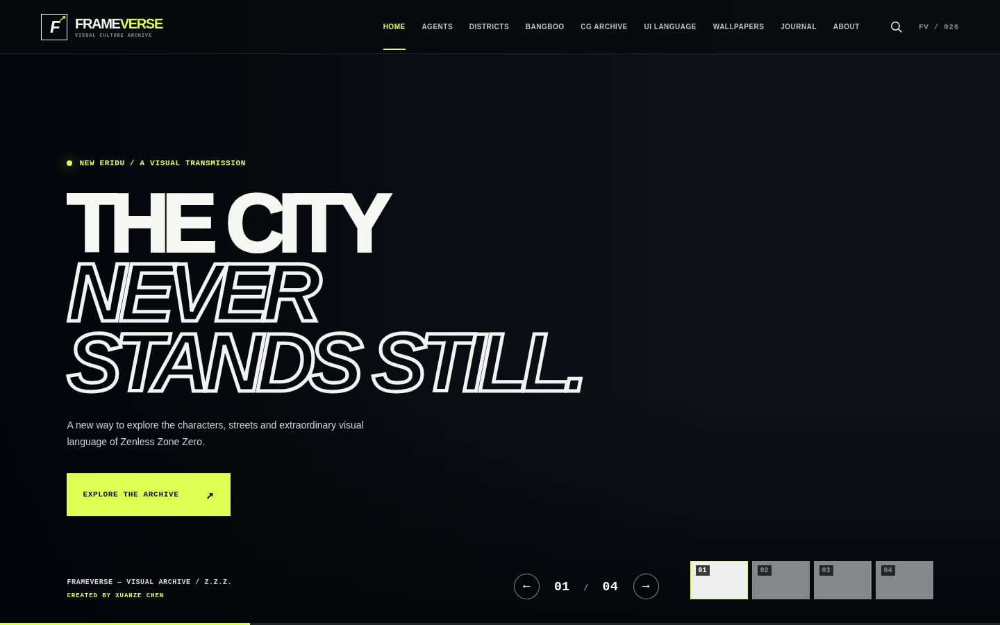

# FRAMEVERSE / VISUAL CULTURE ARCHIVE

FRAMEVERSE is an independently presented visual archive of **Zenless Zone Zero** aesthetics, scenes, character card layouts, CG art, Bangboo graphics and UI design. It reimagines the earlier figure-collecting site as a graphic / cultural exploration experience.

**This website is independent and unofficial.** Zenless Zone Zero and all game imagery belong to their respective rights holders. The user provided the original art files; this source distribution is for personal/local review and does not grant permission to commercially reuse or publicly republish them.

## Website credits

**Website design and development: Xuanze Chen.** The FRAMEVERSE interface, layout, presentation and website implementation carry this credit in the home hero, About page, footer and page metadata. This credit refers to the FRAMEVERSE website work, **not** ownership of the third-party Zenless Zone Zero character and art assets.

## Run locally

- Double-click `start.command` on macOS or `start.bat` on Windows, **or**
- Run `npm run dev` with Node.js 18+, then visit `http://localhost:4173/`.
- Run `npm test` to validate page structure and media references.

There is no `npm install`: this is a **dependency-free static website** with HTML, CSS, vanilla JavaScript and an optional Node HTTP server. `build.py` generates the pages from `data/archive.json`. The original curated media are stored as optimized WebP files under `media/`.

## Completed routes

- `index.html` — cinematic hero with interactive slide switching, featured character and archive modules
- `agents.html` — searchable character-card visual archive; twelve individual detail pages
- `scenes.html` — 24 curated city images with category filters and full-screen viewer
- `bangboo.html` — 22 Bangboo entries with class filters and viewer
- `cg.html` — 9 CG works with a cinematic gallery
- `ui.html` — 26 posters, illustrations and visual UI pieces
- `wallpapers.html` — 6 optimized wallpapers with local download links
- `journal.html` — four visual editorial entry points (not fabricated current news)
- `about.html` — archive context and explicit unofficial status

## Features

Responsive navigation; accessible search overlay (Cmd/Ctrl+K); image viewer (arrow keys / Escape); hero rotation and manual controls; agent feature switching; functional filters; responsive designs; motion-reduced fallback; asset thumbnails and credits.

## Architecture

- `scripts/prepare_assets.py` — one-time image curation from provided ZIP extractions (not needed to run site)
- `data/archive.json` — curated inventory / descriptions
- `build.py` — statically writes the pages and global search index
- `assets/site.css` — visual system / responsive design
- `assets/site.js` — website interactions / search / lightbox
- `media/` — optimized selected game visual assets
- `tests/` — structural checks

## Image availability and limitations

No standalone transparent full-body character Live2D / 3D assets were provided; character pages use the selected **character-card posters**. The scene screenshots preserve embedded attribution / screenshot identifiers. Real-time events, live game data, authentication, paid services and 3D model viewers are not implemented. No tracking or personal-data collection is enabled.

## Source, version history and deployment

- GitHub repository: https://github.com/xuanz3/FRAMEVERSE
- Automated checks: `.github/workflows/checks.yml` on pushes and pull requests.
- This repository uses actual Git commits, feature branches and merges; it does not artificially backdate activity.
- For the initial remote push, use `PUBLISH_TO_GITHUB.command` on macOS or GitHub Desktop with the repository folder, **including its `.git` directory**.
- After the initial push, connect the repo to Netlify via **Add new project → Import an existing project → GitHub → FRAMEVERSE**. Select an empty build command and `/` as the publish directory.
- Any future change should be made on a feature branch and proposed as a Pull Request.

**Rights note:** The site's bespoke markup, style and interaction code is separate from the third-party Zenless Zone Zero visual materials. Possession of images does not establish redistribution rights. Confirm publisher permissions before public redistribution or commercial use.
